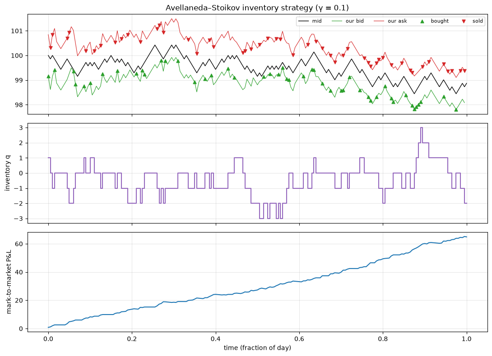
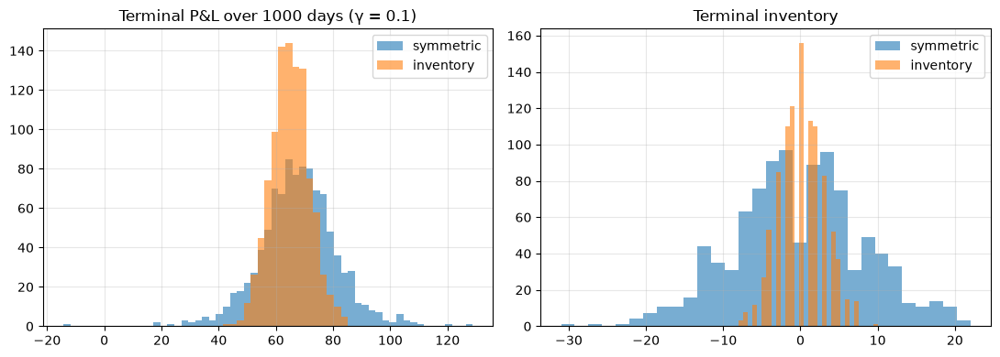
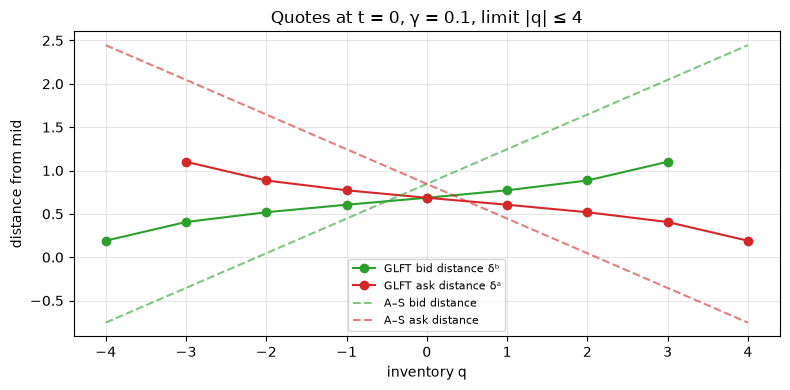
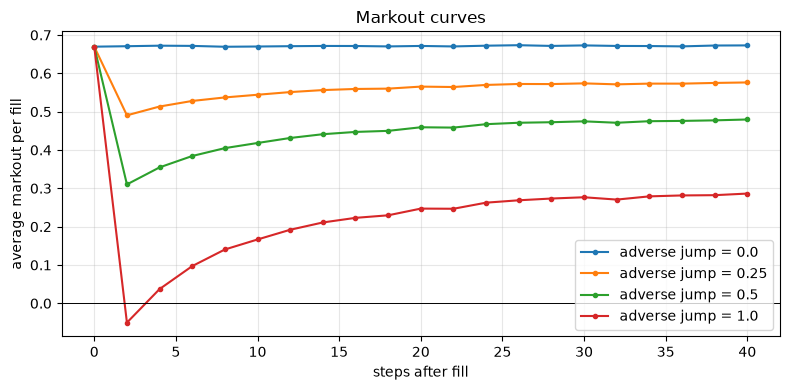

# Market Making with Avellaneda–Stoikov

  

A Monte Carlo study of inventory-aware market making. It **replicates the simulation results of Avellaneda & Stoikov (2008)**, implements the **exact optimal quotes under position limits** of Guéant, Lehalle & Fernandez-Tapia (2013), and measures what **adverse selection** does to a market maker's P&L using markout curves.

## Key results

1,000 simulated trading days per strategy; parameters from the original paper (σ = 2, k = 1.5, A = 140, dt = 0.005).

**Replication of the paper (γ = 0.1)**

| Strategy | Mean P&L | Std P&L | Std final inventory | Paper: mean / std / std q |
|---|---|---|---|---|
| Inventory (A–S) | 64.94 | **6.50** | **2.90** | 62.94 / 5.89 / 1.80 |
| Symmetric | 67.77 | 13.37 | 8.56 | 67.21 / 13.43 / 8.66 |

The inventory-aware strategy gives up about 4% of mean P&L to **halve P&L volatility** and cut inventory risk by two-thirds. Results for γ = 0.01 also track the paper closely. The γ = 0.5 rows don't, because the paper's reported spreads appear to omit the γσ²(T − t) term; the notebook includes a `PAPER_SPREAD` switch to test this.

**P&L attribution (γ = 0.1).** On average, spread capture contributes 64.9 and inventory P&L only 0.1, but inventory P&L drives the risk (std 2.9 vs 11.8 for the symmetric strategy).

**Position limits (|q| ≤ 4).** The exact GLFT solution has the best risk-adjusted P&L (mean/std **10.45**), ahead of A–S with a hard cap (10.17) and a symmetric quoter with a hard cap (8.04).

**Adverse selection.** When fills are followed by price moves against the market maker, the P&L-maximising extra half-spread rises from 0 (uninformed flow) to 0.5 (strongly informed flow).

<p align="center">
  
</p>
<p align="center">
  
</p>
<p align="center">
  
  
</p>

## Methods

| Component | Implementation |
|---|---|
| Price dynamics | Arithmetic random walk, dS = σ dW (binomial steps) |
| Fills | Poisson arrivals with intensity λ(δ) = A·e^(−kδ) at distance δ from the mid |
| A–S quotes | Reservation price r = S − qγσ²(T − t); total spread γσ²(T − t) + (2/γ)·ln(1 + γ/k) |
| GLFT quotes | Value function v(t) = exp(−M(T − t))·1 with tridiagonal M; computed with `scipy.linalg.expm` |
| Adverse selection | After each fill the mid jumps against the filled side; measured with markouts at 0–40 steps |
| Simulation | Vectorised over 1,000 paths in numpy (a few seconds per experiment) |

## Repository structure

```
avellaneda-stoikov-market-making/
├── avellaneda_stoikov_market_making.ipynb   # full study, with saved outputs
├── figures/                                  # charts used in this README
├── requirements.txt
└── LICENSE
```

## Getting started

```bash
git clone https://github.com/Gautam-25mm06004/avellaneda-stoikov-market-making.git
cd avellaneda-stoikov-market-making
python -m venv .venv
# Windows: .venv\Scripts\activate     macOS/Linux: source .venv/bin/activate
pip install -r requirements.txt
jupyter lab avellaneda_stoikov_market_making.ipynb
```

No data or internet connection is needed; every result is generated by simulation with fixed random seeds.

## References

1. Avellaneda, M. & Stoikov, S. (2008). *High-frequency trading in a limit order book.* Quantitative Finance 8(3), 217–224. [PDF](https://people.orie.cornell.edu/sfs33/LimitOrderBook.pdf)
2. Guéant, O., Lehalle, C.-A. & Fernandez-Tapia, J. (2013). *Dealing with the inventory risk: a solution to the market making problem.* Mathematics and Financial Economics 7, 477–507. [arXiv:1105.3115](https://arxiv.org/abs/1105.3115)
3. Cartea, Á., Jaimungal, S. & Penalva, J. (2015). *Algorithmic and High-Frequency Trading.* Cambridge University Press, ch. 10.
4. Falces Marín, J. et al. (2022). *A reinforcement learning approach to improve the performance of the Avellaneda-Stoikov market-making algorithm.* PLOS ONE 17(12).

## Limitations

* Prices are continuous and quotes can sit anywhere. Real futures trade on a tick grid where queue priority dominates.
* Volatility and order-arrival parameters are constant and known.
* The adverse-selection model is a stylised jump, not an estimate from real trade data.

## License

MIT. See [LICENSE](LICENSE).

*Research and educational project. Nothing here is investment advice; backtested results do not predict future performance.*
